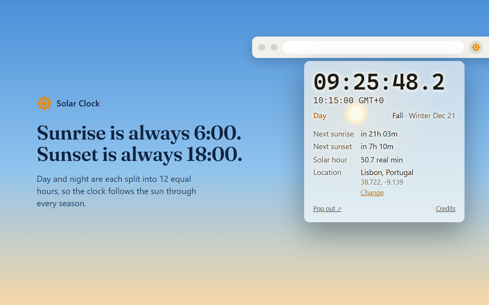

# Solar Clock

A Chrome extension that shows the time on a solar clock: **sunrise is always
6:00, solar noon 12:00 and sunset 18:00**, wherever you are. Day and night are
each split into twelve equal hours, so their real length changes with the
seasons.

- The sun moves across a sky backdrop from sunrise on the left to sunset on
  the right.
- At night: the moon in its current phase, its position in the sky, and the
  date of the next full moon.
- Local time, sunrise and sunset countdowns, and the season.
- Use your current location, or search for any place on Earth.
- Pop the clock out into its own window and put it anywhere on your screen.
- Keeps running through the midnight sun and polar night.

## Install

Solar Clock will be available from the Chrome Web Store. Until then, or if you
prefer, you can install it manually:

1. Download `solar-clock-<version>.zip` from the
   [latest release](https://github.com/dataoutlaw98/solar-clock/releases/latest).
2. Unzip it into a folder you'll keep. Chrome loads the extension from that
   folder, so don't delete or move it afterwards.
3. Open `chrome://extensions` in Chrome (version 127 or later).
4. Turn on **Developer mode** (top right).
5. Click **Load unpacked** and choose the unzipped folder, the one that
   contains `manifest.json`.
6. Optional: click the puzzle-piece icon in the toolbar and pin
   **Solar Clock** so it's always visible.

To update a manual install, unzip the new version over the same folder, then
click the reload button on Solar Clock's card in `chrome://extensions`.

Chrome may show a reminder about extensions in developer mode when it starts;
that's expected for manual installs.

## Privacy

Your location stays on your device, apart from what two map services need to
name places and search for them. No accounts, ads, analytics or tracking. See
the [privacy policy](https://dataoutlaw98.github.io/solar-clock/privacy.html).

## Credits

Developed by Positively Paul (dataoutlaw@gmail.com).

Place names © [OpenStreetMap contributors](https://www.openstreetmap.org/copyright);
search by [Photon](https://photon.komoot.io) (Komoot); timezone lookup by
[tz-lookup](https://github.com/photostructure/tz-lookup). Sun icon by
[Font Awesome](https://fontawesome.com),
[CC BY 4.0](https://creativecommons.org/licenses/by/4.0/).
